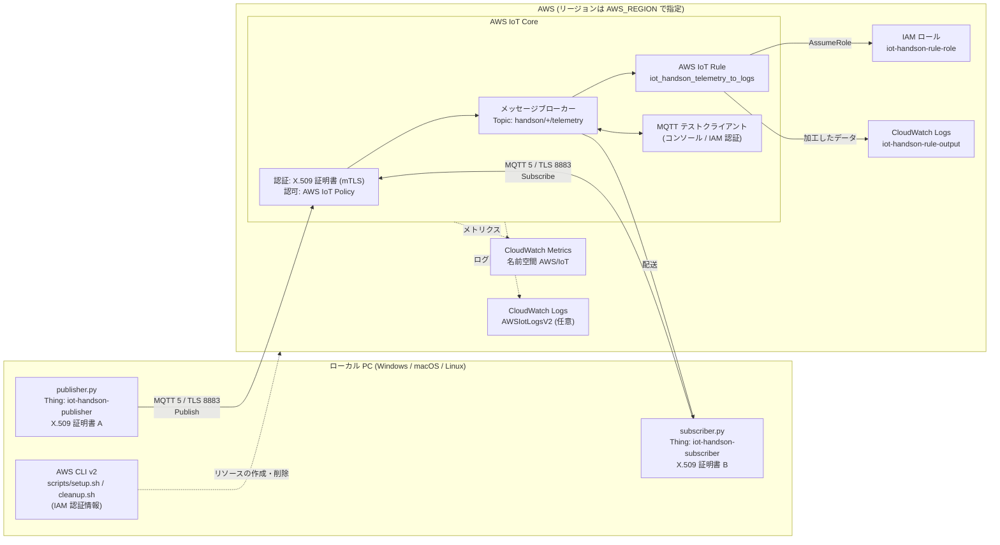

# AWS IoT Core ハンズオン

## 1. このリポジトリについて

実機の IoT デバイスを購入せず、**ローカル PC を仮想デバイスとして AWS IoT Core に接続**し、MQTT 通信・認証認可・データ処理・可観測性を自分の AWS 環境で再現するための学習・技術検証用ハンズオンです。AWS IoT Core を初めて扱うバックエンドエンジニアを対象にしています。

| パス | 内容 |
| --- | --- |
| `src/publisher.py` | ダミーテレメトリを Publish するデバイス役 |
| `src/subscriber.py` | テレメトリを Subscribe するアプリケーション役 (欠落・重複を検出) |
| `src/telemetry_generator.py` | ダミーテレメトリ (JSON) の生成 |
| `src/common.py` | `.env` の読み込みと MQTT 5 クライアント生成 (接続状態のログ出力) |
| `scripts/setup.sh` | ハンズオン用 AWS リソースの作成 (再実行可能) |
| `scripts/cleanup.sh` | 作成したリソースの削除 (再実行可能) |
| `scripts/common.sh` | 上記 2 つが共有するリソース名とヘルパー |
| `requirements.txt` | Python 依存関係 (バージョン固定) |
| `.env.example` | Python スクリプト用設定のひな形 |
| `docs/aws-cli-sso-setup.md` | AWS CLI v2 のインストールと SSO ログイン手順 |

> **検証状況について (重要)**
> このハンズオンは **実際の AWS アカウントでは未検証** です。作成時の作業環境から AWS に接続できなかったため、ローカルの MQTT ブローカーと AWS モックで検証しています。また AWS 公式サイト (docs.aws.amazon.com / aws.amazon.com) を直接閲覧できませんでした。何を確認でき、何が未確認かは [12. 参考資料](#12-参考資料) にまとめています。

## 2. 学習目標

このハンズオンを終えると、次のことを説明・再現できるようになります。

- AWS IoT Core の役割と、MQTT の Publish / Subscribe モデル
- QoS 0 と QoS 1 の違い、および AWS IoT Core での制約
- X.509 クライアント証明書による認証と、AWS IoT Policy による認可 (最小権限)
- 「認証の失敗」と「認可の失敗」の見え方の違い
- 証明書の無効化が接続に与える影響
- AWS IoT Rules によるメッセージの加工と転送
- CloudWatch Metrics / Logs による監視と障害の切り分け
- **AWS IoT Core が提供する機能**と **SDK が提供する機能 (再接続・再送)** の区別

## 3. AWS IoT Core の概要

AWS IoT Core は、デバイスとクラウドを接続するマネージドサービスです。サーバーを管理せずに、多数のデバイスとの双方向通信を扱えます。このハンズオンで扱う構成要素は次のとおりです。

| 構成要素 | 役割 |
| --- | --- |
| デバイスゲートウェイ / メッセージブローカー | デバイスからの MQTT / HTTPS 接続を受け付け、Topic に基づいてメッセージを配送する |
| 認証 (X.509 証明書など) | 接続してきたのが誰かを TLS の相互認証で確認する |
| 認可 (AWS IoT Policy) | 認証されたクライアントに、どのクライアント ID・Topic の操作を許すかを決める |
| レジストリ (Thing) | デバイスを表す論理的な台帳。証明書と関連付ける |
| ルールエンジン (AWS IoT Rules) | SQL でメッセージを選別・加工し、他の AWS サービスへ転送する |

Device Shadow、Jobs、Fleet Provisioning、Greengrass などは扱いません。

### MQTT と HTTP の違い

| 観点 | MQTT | HTTPS |
| --- | --- | --- |
| 通信モデル | Publish / Subscribe (常時接続) | リクエスト / レスポンス |
| AWS IoT Core での操作 | Publish と Subscribe | **Publish のみ** |
| クラウドからデバイスへの通知 | Subscribe していれば即時に届く | デバイス側からのポーリングが必要 |
| 配送保証 | QoS 0 / 1 | クエリ文字列 `?qos=` で 0 / 1 を指定 |
| 向いている用途 | 継続的なテレメトリ、双方向制御 | 低頻度の送信のみを行う機器 |

AWS IoT Core は **MQTT 3.1.1 と MQTT 5 の両方**をサポートします。このハンズオンでは、認可失敗などの理由を Reason Code として受け取れる MQTT 5 を使用します。

### Broker・Topic・Publisher・Subscriber の関係

- **Publisher** は Topic (例: `handson/iot-handson-publisher/telemetry`) を指定してメッセージを送ります。宛先のクライアントは指定しません。
- **Subscriber** は Topic フィルター (例: `handson/+/telemetry`) をブローカーに登録します。
- **ブローカー**が Topic とフィルターを照合し、一致した Subscriber へ配送します。Publisher と Subscriber は互いを知りません。
- Topic フィルターのワイルドカード: `+` は 1 階層、`#` はそれ以下すべての階層に一致します。

### QoS 0 と QoS 1 の違い

| | QoS 0 | QoS 1 |
| --- | --- | --- |
| 配送回数 | 0 回以上 (届かないことがある) | 1 回以上 (重複することがある) |
| 確認応答 | なし | `PUBACK` を受け取るまで完了しない |
| 送信側が到達を確認できるか | できない | できる |
| 向いている用途 | 欠落しても次の値で補える高頻度データ | 欠落させたくないイベント |

AWS IoT Core 固有の注意点:

- **QoS 2 はサポートされません。**
- QoS 0 でも稀に重複配送されることがあります。
- メッセージの**順序は保証されません**。
- 同じクライアント ID で 2 つ目の接続が来ると、**先に接続していた側が切断されます**。
- QoS 1 でも重複はあり得るため、受信側は**冪等に処理できる設計**が必要です (本ハンズオンのペイロードに `sequence` を入れているのはそのためです)。

## 4. システム構成図



ポイント:

- **デバイス (Python) は X.509 証明書だけで接続**し、AWS アクセスキーを持ちません。
- **管理操作 (AWS CLI) とコンソールは IAM で認証**します。両者の経路と権限は完全に分かれています。
- EC2、NAT Gateway、Lambda など、常時稼働や追加課金につながるリソースは作成しません。

## 5. 前提条件

| 項目 | 内容 |
| --- | --- |
| OS | Windows / macOS / Linux |
| シェル | bash (Windows は **Git Bash** または **WSL** を使用。本 README のコマンドは bash 前提) |
| AWS CLI | v2 ([インストールと SSO ログイン手順](docs/aws-cli-sso-setup.md)) |
| Python | 3.8 以上 (SDK の要件)。3.12 で動作確認 |
| AWS アカウント | 学習・検証用のアカウントを推奨 |
| その他 | `curl`、`openssl` (Step 4 の認証失敗の検証で使用) |

### 作業者 (AWS CLI) に必要な IAM 権限

AWS CLI を実行するユーザー / ロールに、次の操作が必要です。**長期アクセスキーではなく、IAM Identity Center (SSO) などの一時認証情報**を使ってください。

- AWS IoT: Thing・証明書・Policy・Topic Rule の作成 / 参照 / 削除、`iot:DescribeEndpoint`、(任意) `iot:GetV2LoggingOptions` / `iot:SetV2LoggingOptions`
- IAM: `iam:CreateRole`、`iam:GetRole`、`iam:UpdateAssumeRolePolicy`、`iam:PutRolePolicy`、`iam:ListRolePolicies`、`iam:DeleteRolePolicy`、`iam:DeleteRole`、`iam:PassRole` (対象: `iot-handson-*` ロール)
- CloudWatch Logs: ロググループの作成 / 参照 / 削除、保持期間の設定、ログの参照
- CloudWatch: `cloudwatch:GetMetricStatistics`
- STS: `sts:GetCallerIdentity`

### 環境変数

| 変数 | 既定値 | 用途 |
| --- | --- | --- |
| `AWS_REGION` | `ap-northeast-1` | リソースを作成するリージョン |
| `AWS_PROFILE` | (AWS CLI の既定) | 使用する AWS CLI プロファイル |
| `PROJECT_PREFIX` | `iot-handson` | リソース名の接頭辞 |
| `IOT_TOPIC_ROOT` | `handson` | Topic の先頭セグメント |

`setup.sh` と `cleanup.sh` は**同じ値**で実行してください (値が違うと別のリソースを対象にします)。

## 6. 料金とセキュリティ上の注意点

### 料金

AWS IoT Core は従量課金で、最低料金や常時稼働リソースはありません。主な課金対象は次のとおりです。

| 課金対象 | 単位 | 参考単価 (未確認) |
| --- | --- | --- |
| 接続 | 接続時間 (分) | 約 0.08 USD / 100 万分 |
| メッセージング | メッセージ数 (5 KB 単位で計量) | 約 1.00 USD / 100 万件 |
| ルールエンジン | ルールの起動回数とアクション実行回数 | 各 約 0.15 USD / 100 万回 |
| CloudWatch Logs | 取り込み量と保管量 | CloudWatch の料金による |

> **単価は未確認の参考値です。** 公式料金ページを直接閲覧できなかったため、検索ツール経由で得た米国リージョン相当の値を記載しています。単価はリージョンにより異なり、変更されることがあります。**必ず [AWS IoT Core の料金](https://aws.amazon.com/iot-core/pricing/) で最新の値を確認してください。**

- **想定費用**: 本ハンズオンの利用量は数百メッセージ・数十分の接続程度で、上記の参考単価では 0.01 USD に満たない見込みです (実環境での請求額は未確認)。
- **無料利用枠**: 従来は「アカウント作成から 12 か月間、月あたり接続 225 万分・メッセージ 50 万件など」の無料枠がありました。2025 年 7 月 15 日以降に作成されたアカウントはクレジット方式の無料プランに変わったとの情報があります。**どちらが適用されるかはアカウントによって異なるため、AWS Billing コンソールで確認してください** (いずれも検索ツール経由の情報で、公式ページでは未確認)。
- **課金を増やす操作**: `--count 0` (無制限送信) の放置、AWS IoT Core のログレベル `DEBUG`、永続セッションに大量のメッセージを滞留させること。
- **課金を残さないために**: 終了後は必ず [11. クリーンアップ](#11-クリーンアップ) を実行してください。ロググループには 3 日間の保持期間を設定しています。

### セキュリティ

- **秘密鍵はコミットしない。** `certs/`、`*.pem`、`*.key`、`*.crt`、`.env` は `.gitignore` で除外しています。コミット前に `git status` で確認してください。
- **AWS アクセスキーをコードや `.env` に書かない。** デバイス役の Python は X.509 証明書のみを使用し、AWS CLI は `AWS_PROFILE` / SSO の一時認証情報を使用します。
- **秘密鍵は発行時の 1 回しか取得できません。** `setup.sh` は所有者のみ読み書き可能 (`600`) で保存します。紛失した場合は証明書を作り直します。
- **AWS IoT Policy は最小権限**にしています。`iot:*` や `Resource: "*"` は使っていません (詳細は Step 4)。
- **AWS IoT Core のログ出力はアカウント・リージョン単位の設定**です。`--with-logging` は、既に別の設定がある場合は変更せずに停止します。
- 実在する機器や業務システムの情報は使用していません。テレメトリはすべて乱数です。
- 学習用の簡略化として、秘密鍵をファイルで PC に保存しています。**本番環境ではセキュアエレメントや TPM などのハードウェアで鍵を保護**し、デバイスごとに固有の証明書を使用してください。

## 7. ハンズオン手順

所要時間の目安は 60〜90 分です。コマンドはリポジトリのルートで実行します。

### Step 0: 作業環境の準備

**目的**: Python の依存関係を固定バージョンでインストールし、AWS CLI の接続先を確認します。

```bash
# 仮想環境の作成と有効化
python3 -m venv .venv          # Windows は python -m venv .venv
source .venv/bin/activate      # Windows (Git Bash) は source .venv/Scripts/activate
pip install -r requirements.txt

# AWS CLI の接続先 (リージョンとプロファイル) を指定
export AWS_REGION=ap-northeast-1
export AWS_PROFILE=default     # 自分のプロファイル名。SSO の場合は先に aws sso login
aws sts get-caller-identity
```

**コマンドの説明**: `requirements.txt` は `awsiotsdk` (AWS IoT Device SDK for Python v2) と、その基盤である `awscrt` のバージョンを固定しています。`get-caller-identity` は、これから操作するアカウントと実行者を表示します。

**期待される結果**: `pip` がエラーなく完了し、`get-caller-identity` が意図したアカウント ID を返す。

**失敗した場合の確認ポイント**:

- `Unable to locate credentials` / `Token has expired`: `aws sso login` をやり直す。`AWS_PROFILE` の値を確認する。
- `awscrt` のビルドが始まって失敗する: Python のバージョンが古い可能性があります。3.8 以上を使用し、`pip install --upgrade pip` を試してください。

### Step 1: AWS IoT Core の基礎

**目的**: 手を動かす前に、[3. AWS IoT Core の概要](#3-aws-iot-core-の概要) の内容を確認し、送信するデータの形を把握します。

```bash
python src/telemetry_generator.py --count 3
```

**コマンドの説明**: AWS には接続せず、これから Publish するダミーテレメトリを表示します。`sequence` は 1 ずつ増える連番で、Subscriber 側で欠落と重複を検出するために使います。

**期待される結果**:

```json
{"device_id": "sample-device", "sequence": 1, "timestamp": "2026-11-11T12:52:58.518+00:00", "temperature_c": 23.9, "humidity_pct": 51.4, "battery_pct": 99.8}
```

**確認しておくこと**: 次の問いに答えられれば次へ進みます。

1. Publisher は Subscriber の存在を知っているか。(知らない。Topic だけを指定する)
2. HTTPS で Subscribe できるか。(できない。Publish のみ)
3. QoS 1 で届いたメッセージは重複しないか。(重複し得る)

### Step 2: 接続準備

**目的**: デバイスが接続するために必要な「Thing・X.509 証明書・IoT Policy・エンドポイント」を用意し、相互の関係を理解します。

```bash
./scripts/setup.sh
```

**コマンドの説明**: 次のリソースを作成し、`.env` を生成します。何度実行しても同じ状態になります。

| 順序 | リソース | 名前 (既定) |
| --- | --- | --- |
| 1 | IoT Policy × 2 | `iot-handson-publisher-policy` / `iot-handson-subscriber-policy` |
| 2 | Thing × 2 と X.509 証明書 × 2 | `iot-handson-publisher` / `iot-handson-subscriber` |
| 3 | IAM ロール・ロググループ・IoT Rule (Step 5 で使用) | `iot-handson-rule-role` / `iot-handson-rule-output` / `iot_handson_telemetry_to_logs` |
| 4 | データエンドポイントの取得と `.env` の生成 | — |

Publisher 用と Subscriber 用に Thing と証明書を分けているのは、**同じクライアント ID では同時に接続できない**ことと、**役割ごとに権限を分ける**ためです。

`setup.sh` が Publisher について実行している主なコマンドは次のとおりです (解説用。手で実行する必要はありません)。

```bash
# (1) Thing: デバイスを表す台帳。これ自体は権限を持たない
aws iot create-thing --thing-name iot-handson-publisher

# (2) 証明書と鍵ペアの発行。秘密鍵を取得できるのはこの 1 回だけ
aws iot create-keys-and-certificate --set-as-active \
  --certificate-pem-outfile certs/publisher/certificate.pem.crt \
  --private-key-outfile certs/publisher/private.pem.key \
  --query certificateId --output text

# (3) Policy: 何を許可するか (内容は Step 4 で確認)
aws iot create-policy --policy-name iot-handson-publisher-policy --policy-document "<JSON>"

# (4) 証明書に Policy をアタッチ (認可) し、Thing に証明書を関連付ける
aws iot attach-policy --policy-name iot-handson-publisher-policy --target "<証明書 ARN>"
aws iot attach-thing-principal --thing-name iot-handson-publisher --principal "<証明書 ARN>"

# (5) アカウント・リージョン固有の接続先
aws iot describe-endpoint --endpoint-type iot:Data-ATS --query endpointAddress --output text
```

関係を整理すると、**認証の主体は証明書**、**権限は証明書にアタッチした Policy**、**Thing は証明書と結び付く名札**です。本ハンズオンの Policy は「証明書に関連付けられた Thing の名前とクライアント ID が一致する場合だけ接続を許可」しているため、(4) の 2 つのアタッチは両方必要です。

**期待される結果**: 最後に `セットアップが完了しました。` と表示され、次のファイルができる。

```text
.env
certs/AmazonRootCA1.pem
certs/publisher/{certificate.pem.crt, private.pem.key, certificate-id.txt}
certs/subscriber/{certificate.pem.crt, private.pem.key, certificate-id.txt}
```

**接続確認**:

```bash
python src/publisher.py --count 1
```

```text
[接続] 試行 #1: xxxxxxxxxxxxxx-ats.iot.ap-northeast-1.amazonaws.com:8883 client_id=iot-handson-publisher
[接続] 成功: CONNACK reason=SUCCESS(0) session_present=False ...
[Publish] seq=1 PUBACK=SUCCESS(0) 35ms temperature_c=24.1
[結果] 送信=1 PUBACK成功=1 拒否=0 失敗=0 接続試行=1 切断=0
```

**失敗した場合の確認ポイント**:

- `AccessDenied` (setup.sh): [5. 前提条件](#5-前提条件) の IAM 権限を確認する。
- `Amazon Root CA 1 を取得できませんでした`: 警告であり続行できます。OS の信頼ストアでサーバー証明書を検証します。
- 接続が `AWS_IO_SOCKET_TIMEOUT` などで失敗する: 社内ネットワークで 8883 番ポートが遮断されている可能性があります。`.env` の `IOT_PORT` を `443` に変更してください (SDK が ALPN を使って 443 番で MQTT 接続します)。
- 接続が TLS エラーで失敗する: `.env` の `IOT_ENDPOINT` が `setup.sh` を実行したリージョンのものか、証明書と秘密鍵の組み合わせが正しいかを確認する。
- 途中で失敗した場合は、原因を解消して `./scripts/setup.sh` を再実行する。

### Step 3: MQTT 通信

**目的**: Publish / Subscribe を実際に動かし、QoS 0 と QoS 1 の違いを観察します。

#### 3-1. Publish と Subscribe

ターミナルを 2 つ開き、どちらも仮想環境を有効化します。

```bash
# ターミナル 1: Subscriber (Ctrl+C で終了)
python src/subscriber.py

# ターミナル 2: Publisher
python src/publisher.py --count 10 --interval 1 --qos 1
```

**コマンドの説明**: Subscriber は Topic フィルター `handson/+/telemetry` を登録します。Publisher は `handson/iot-handson-publisher/telemetry` へ JSON を 1 秒間隔で 10 件送ります。`+` が Thing 名の階層に一致するため配送されます。

**期待される結果**: ターミナル 1 に 10 件表示され、終了時 (Ctrl+C) に `受信=10 重複=0 欠落=0` と表示される。

```text
[Subscribe] SUBACK=['GRANTED_QOS_1(1)']
[受信] topic=handson/iot-handson-publisher/telemetry qos=1 payload={"device_id": "iot-handson-publisher", "sequence": 1, ...}
```

#### 3-2. QoS 0 と QoS 1 の比較

```bash
python src/publisher.py --count 5 --qos 0
python src/publisher.py --count 5 --qos 1
```

**期待される結果**: QoS 0 は `送信のみ (QoS 0: 確認応答なし)`、QoS 1 は `PUBACK=SUCCESS(0) 35ms` のように応答と所要時間が表示される。QoS 1 では「ブローカーが受け取った」ことを送信側が確認できます (Subscriber に届いたことの確認ではありません)。

#### 3-3. 切断中のメッセージ (永続セッション)

QoS の違いが最もはっきり現れるのは、受信側が切断している間です。

```bash
# (1) 永続セッション (有効期間 300 秒) で Subscribe し、Ctrl+C で止める
python src/subscriber.py --session-expiry 300

# (2) Subscriber が止まっている間に QoS 1 を 3 件、QoS 0 を 3 件 Publish する
python src/publisher.py --count 3 --qos 1
python src/publisher.py --count 3 --qos 0

# (3) 同じ設定で Subscriber を再開する
python src/subscriber.py --session-expiry 300
```

**コマンドの説明**: `--session-expiry` を指定すると、ブローカーは切断後もセッション (Subscribe の内容と未配送の QoS 1 メッセージ) を保持します。

**期待される結果**: (3) の接続ログが `session_present=True` になり、**QoS 1 の 3 件だけ**が再接続直後に届く。QoS 0 の 3 件は保持されない。`--session-expiry` を付けない場合はどちらも届かない。

> 永続セッションに保存されたメッセージは、保存時と配送時にメッセージ料金の対象になります。検証後は `--session-expiry` なしで一度接続するとセッションが破棄されます。

#### 3-4. MQTT テストクライアント (コンソール)

1. AWS マネジメントコンソールで AWS IoT Core を開き、リージョンが `AWS_REGION` と同じであることを確認する。
2. 左メニューの **MQTT テストクライアント** を開く。
3. **トピックをサブスクライブする** で `handson/#` を入力してサブスクライブする。
4. ターミナルで `python src/publisher.py --count 5` を実行し、コンソールにメッセージが表示されることを確認する。
5. **トピックに公開する** で Topic に `handson/console-test/telemetry`、ペイロードに `{"device_id": "console-test", "sequence": 1, "temperature_c": 30}` を入力して発行し、ターミナルの Subscriber に届くことを確認する。

**何を検証しているか**: テストクライアントは**コンソールにログインした IAM の権限**で接続します (MQTT over WebSocket + 署名バージョン 4)。X.509 証明書の Policy では許可していない `handson/#` を Subscribe できるのは、認証方式と権限の持ち主が違うためです。

**失敗した場合の確認ポイント**:

- Subscriber に何も届かない: 両方が同じリージョン・同じ `.env` を使っているか確認する。Publisher 側が `PUBACK=SUCCESS` になっているか確認する。
- Subscriber と Publisher が交互に切断される: 同じクライアント ID で 2 つ起動していないか確認する (`--client-id` を指定していないか)。
- コンソールに表示されない: コンソールのリージョンを確認する。

### Step 4: 認証・認可の検証

**目的**: 最小権限の Policy が実際に境界として機能することを、**拒否される操作を試して**確認します。

#### 4-1. Policy の確認

```bash
aws iot get-policy --policy-name iot-handson-publisher-policy \
  --query policyDocument --output text
aws iot get-policy --policy-name iot-handson-subscriber-policy \
  --query policyDocument --output text
```

**期待される結果** (Publisher。アカウント ID とリージョンは環境の値):

```json
{
  "Version": "2012-10-17",
  "Statement": [
    {
      "Effect": "Allow",
      "Action": "iot:Connect",
      "Resource": "arn:aws:iot:ap-northeast-1:123456789012:client/${iot:Connection.Thing.ThingName}"
    },
    {
      "Effect": "Allow",
      "Action": "iot:Publish",
      "Resource": "arn:aws:iot:ap-northeast-1:123456789012:topic/handson/${iot:Connection.Thing.ThingName}/telemetry"
    }
  ]
}
```

設計のポイント:

| アクション | リソース種別 | このハンズオンでの許可範囲 |
| --- | --- | --- |
| `iot:Connect` | `client/<クライアント ID>` | 証明書に関連付けた Thing 名と同じクライアント ID のみ |
| `iot:Publish` | `topic/<Topic>` | Publisher: 自分の Thing 名を含む Topic のみ |
| `iot:Subscribe` | `topicfilter/<フィルター>` | Subscriber: `handson/+/telemetry` というフィルターのみ |
| `iot:Receive` | `topic/<Topic>` | Subscriber: `handson/*/telemetry` に一致する Topic のみ |

- `${iot:Connection.Thing.ThingName}` は **Policy 変数**です。Policy を 1 つ書けば、デバイスごとに「自分の Topic だけ」に制限できます。
- **Policy の中では MQTT のワイルドカード `+` `#` は単なる文字**として扱われます。`topicfilter/handson/+/telemetry` は「`handson/+/telemetry` という文字列のフィルター」だけを許可します。Policy のワイルドカードは `*` です。
- Subscribe (フィルターの登録) と Receive (メッセージの受信) は別のアクションで、両方の許可が必要です。
- Publisher には Subscribe / Receive を、Subscriber には Publish を許可していません。

#### 4-2. 許可されていない Topic への Publish

```bash
python src/publisher.py --count 1 --topic handson/other-device/telemetry
```

**期待される結果**: Publish が拒否され、終了コードが 1 になる。MQTT 5 では接続は維持され、`PUBACK` の Reason Code で理由が返る想定です。

```text
[Publish] seq=1 拒否: PUBACK=NOT_AUTHORIZED(135) reason_string=...
[結果] 送信=1 PUBACK成功=0 拒否=1 失敗=0 ...
```

> 実 AWS 環境での表示は未確認です。Reason Code ではなく切断 (`[切断] ...` と `失敗: ...`) として現れた場合も、認可による拒否です。MQTT 3.1.1 では理由を伝える手段がなく、切断になります。

#### 4-3. 許可されていないフィルターでの Subscribe

```bash
python src/subscriber.py --topic-filter 'handson/#' --duration 5
```

**期待される結果**: `SUBACK=['NOT_AUTHORIZED(135)']` と `[Subscribe] 拒否されました` が表示され、終了コードが 1 になる。

#### 4-4. 許可されていないクライアント ID での接続 (認可の失敗)

```bash
python src/publisher.py --count 1 --client-id rogue-client --connect-timeout 10
```

**期待される結果**: 証明書は正しいため TLS は成立しますが、`iot:Connect` が許可されず接続が拒否されます。`[接続] 失敗` が繰り返され、`[エラー] 接続できませんでした` で終了する。

#### 4-5. 未登録の証明書での接続 (認証の失敗)

```bash
mkdir -p certs/unregistered
openssl req -x509 -newkey rsa:2048 -nodes -days 1 -subj "/CN=unregistered-device" \
  -keyout certs/unregistered/private.pem.key -out certs/unregistered/certificate.pem.crt

PUBLISHER_CERT_FILE=certs/unregistered/certificate.pem.crt \
PUBLISHER_KEY_FILE=certs/unregistered/private.pem.key \
python src/publisher.py --count 1 --connect-timeout 10
```

**コマンドの説明**: AWS IoT Core に登録されていない自己署名証明書を作り、それで接続を試みます。Git Bash では `-subj "//CN=unregistered-device"` と先頭のスラッシュを 2 つにしてください。

**期待される結果**: `CONNACK 未受信` のまま TLS のエラー (`AWS_IO_TLS_ERROR_...` など) で失敗する。MQTT のやり取りが始まる前に拒否されています。

#### 4-6. 認証の失敗と認可の失敗の違い

| | 認証の失敗 (4-5) | 認可の失敗 (4-2〜4-4) |
| --- | --- | --- |
| 問われていること | 誰か (証明書は登録済みで有効か) | 何をしてよいか (Policy が許可しているか) |
| 失敗する層 | TLS ハンドシェイク | MQTT (`CONNECT` / `PUBLISH` / `SUBSCRIBE`) |
| クライアントでの見え方 | TLS エラー、`CONNACK 未受信` | `CONNACK` / `PUBACK` / `SUBACK` の Reason Code、または切断 |
| 主な原因 | 未登録・INACTIVE・失効した証明書、鍵の不一致 | Policy の不足、クライアント ID や Topic の不一致、Policy の未アタッチ |
| 確認する場所 | 証明書の状態 (`describe-certificate`) | Policy の内容とアタッチ状況、AWS IoT のログ |

#### 4-7. 証明書の無効化

```bash
# ターミナル 1: 5 秒間隔で送り続ける (Ctrl+C で終了)
python src/publisher.py --count 0 --interval 5

# ターミナル 2: 証明書を無効化する
aws iot update-certificate --new-status INACTIVE \
  --certificate-id "$(cat certs/publisher/certificate-id.txt)"
```

**期待される結果**: **数分以内に**ターミナル 1 が `[切断]` を表示し、以降は SDK が再接続を試みては `[接続] 失敗` になる。無効化は既存の接続にも及びますが、即時ではありません。

```bash
# ターミナル 2: 証明書を有効に戻す
aws iot update-certificate --new-status ACTIVE \
  --certificate-id "$(cat certs/publisher/certificate-id.txt)"
```

**期待される結果**: プログラムを再起動しなくても、SDK の自動再接続によって `[接続] 成功` になり、送信が再開する。確認後は Ctrl+C で止めます。

証明書の状態と使い分け:

| 操作 | 状態 | 元に戻せるか | 用途 |
| --- | --- | --- | --- |
| 無効化 | `INACTIVE` | 戻せる (`ACTIVE`) | 一時停止、調査中の隔離 |
| 失効 | `REVOKED` | 戻せない | 鍵の漏えいなど、二度と使わせない場合 |
| 削除 | — | 戻せない | 廃棄。Policy のデタッチと無効化が先に必要 |

**ローテーションの考え方**: 新しい証明書を発行して同じ Policy と Thing にアタッチ → デバイスを新しい証明書に切り替えて接続を確認 → 古い証明書を `INACTIVE` にして影響がないことを確認 → 古い証明書を削除、の順に行います。新旧を一時的に併存させることで、通信を止めずに入れ替えられます。

**失敗した場合の確認ポイント**:

- 4-2〜4-4 が成功してしまう: 証明書に別の緩い Policy がアタッチされていないか確認する (`aws iot list-attached-policies --target <証明書 ARN>`)。
- 4-7 で切断されない: 数分待つ。`aws iot describe-certificate --certificate-id ... --query certificateDescription.status` で状態を確認する。
- 4-7 の後に接続できない: 証明書が `ACTIVE` に戻っているか確認する。`./scripts/setup.sh` の再実行でも `ACTIVE` に戻ります。

### Step 5: データ処理

**目的**: AWS IoT Rules でメッセージを選別・加工し、CloudWatch Logs へ転送します。デバイス側のコードを変えずにクラウド側の処理を追加できることを確認します。

#### 5-1. Rule の確認

```bash
aws iot get-topic-rule --rule-name iot_handson_telemetry_to_logs \
  --query 'rule.{sql: sql, actions: actions}'
```

**期待される結果**: Step 2 で作成済みの Rule が表示される。

```sql
SELECT topic(2) AS device_id,
       sequence,
       temperature_c,
       temperature_c * 9 / 5 + 32 AS temperature_f,
       humidity_pct,
       timestamp() AS processed_at_ms
FROM 'handson/+/telemetry'
WHERE temperature_c >= 25
```

| 句 | 行っている処理 |
| --- | --- |
| `FROM` | 対象の Topic フィルター。Subscriber と同じく、ブローカーに届いたメッセージを受け取る |
| `WHERE` | 25℃ 以上のメッセージだけを通す (選別) |
| `topic(2)` | Topic の 2 階層目 (Thing 名) を取り出す。ペイロードの自己申告ではなく、認可済みの Topic から得る |
| `temperature_c * 9 / 5 + 32` | 摂氏から華氏への変換 (加工) |
| `timestamp()` | ルールエンジンが処理した時刻 (ミリ秒) の付与 |
| `battery_pct` を含めない | 不要な項目の除去 |

アクションは `cloudwatchLogs` で、IAM ロール `iot-handson-rule-role` を引き受けてロググループ `iot-handson-rule-output` に書き込みます。このロールの権限は、そのロググループへの `logs:CreateLogStream` / `logs:DescribeLogStreams` / `logs:PutLogEvents` のみです。信頼ポリシーでは `aws:SourceAccount` と `aws:SourceArn` を条件にし、他のアカウントの AWS IoT から使われないようにしています。

#### 5-2. データを流して結果を確認

```bash
python src/publisher.py --count 20 --interval 0.5
aws logs tail iot-handson-rule-output --since 10m
```

**期待される結果**: 25℃ 以上だったメッセージだけが、加工後の形で表示される (反映まで数十秒かかることがあります)。Publisher の出力の `temperature_c` と見比べてください。

```json
{"device_id":"iot-handson-publisher","sequence":3,"temperature_c":25.4,"temperature_f":77.72,"humidity_pct":49.1,"processed_at_ms":1794401560123}
```

**AWS Lambda について**: 本ハンズオンの加工は SQL だけで完結するため、Lambda は使用していません。外部 API の呼び出しや複数メッセージをまたぐ処理など SQL で表現できない処理が必要になった場合に、Rule のアクションとして Lambda を追加します ([10. 発展的な検証テーマ](#10-発展的な検証テーマ))。

**失敗した場合の確認ポイント**:

- 何も表示されない: 送信した値がすべて 25℃ 未満だった可能性があります。件数を増やして再実行する。
- それでも表示されない: Step 6 のメトリクスで `TopicMatch` (Rule に一致した数) と `Failure` (アクションの失敗数) を確認する。`Failure` が増えていれば IAM ロールの権限か信頼ポリシーの問題です。Step 6 のログ出力を有効にすると、失敗の理由が記録されます。
- `ResourceNotFoundException`: `AWS_REGION` が `setup.sh` 実行時と同じか確認する。

### Step 6: 可観測性と障害検証

**目的**: 問題が起きたときに「どこで・なぜ」失敗したかを切り分けられるようにします。

#### 6-1. CloudWatch Metrics

AWS IoT Core は名前空間 `AWS/IoT` にメトリクスを自動で発行します (有効化の設定は不要)。

```bash
START=$(python -c "import datetime as d; print((d.datetime.now(d.timezone.utc) - d.timedelta(minutes=60)).strftime('%Y-%m-%dT%H:%M:%SZ'))")
END=$(python -c "import datetime as d; print(d.datetime.now(d.timezone.utc).strftime('%Y-%m-%dT%H:%M:%SZ'))")

for metric in Connect.Success Connect.AuthError PublishIn.Success PublishIn.AuthError Subscribe.AuthError PublishOut.Success; do
  echo "== ${metric}"
  aws cloudwatch get-metric-statistics --namespace AWS/IoT --metric-name "${metric}" \
    --dimensions Name=Protocol,Value=MQTT \
    --start-time "${START}" --end-time "${END}" --period 3600 --statistics Sum \
    --query 'Datapoints[].Sum' --output text
done
```

**コマンドの説明**: 直近 60 分の合計値を取得します。メトリクスの反映には数分かかります。

| メトリクス | 意味 | このハンズオンで増える操作 |
| --- | --- | --- |
| `Connect.Success` | 接続の成功 | すべての接続 |
| `Connect.AuthError` | 認可されなかった接続要求 | Step 4-4 |
| `PublishIn.Success` | ブローカーが受け付けた Publish | Step 3 |
| `PublishIn.AuthError` | 認可されなかった Publish | Step 4-2 |
| `Subscribe.AuthError` | 認可されなかった Subscribe | Step 4-3 |
| `PublishOut.Success` | ブローカーから Subscriber への配送 | Step 3 |
| `TopicMatch` / `Success` / `Failure` | Rule に一致した数 / アクションの成功・失敗 (ディメンションは `RuleName` など) | Step 5 |

**期待される結果**: Step 3〜4 の操作に対応するメトリクスに値が入っている。`AuthError` 系が 0 でない場合、本番環境であれば設定ミスか不正アクセスの兆候としてアラームの対象になります。

#### 6-2. AWS IoT Core のログ出力

メトリクスは「何件失敗したか」は分かりますが、「どのクライアントがなぜ失敗したか」は分かりません。それを知るにはログ出力を有効化します。

```bash
./scripts/setup.sh --with-logging
```

**コマンドの説明**: ログ書き込み用の IAM ロール (`iot-handson-logging-role`) を作成し、`aws iot set-v2-logging-options` で既定のログレベルを `INFO` に設定します。ログはロググループ `AWSIotLogsV2` に出力されます。

> これは**アカウント・リージョン単位の設定**です。既に別のロールでログ出力が設定されている場合、スクリプトは変更せずに停止します。その場合は既存の設定のままログを確認してください。

Step 4-2 と 4-4 をもう一度実行してから、失敗のログを検索します。

```bash
python src/publisher.py --count 1 --topic handson/other-device/telemetry
python src/publisher.py --count 1 --client-id rogue-client --connect-timeout 10

aws logs filter-log-events --log-group-name AWSIotLogsV2 \
  --filter-pattern '{ $.status = "Failure" }' \
  --query 'events[].message' --output text
```

**期待される結果**: `eventType` (`Connect` / `Publish-In` / `Subscribe` など)、`status`、`clientId`、`principalId` (証明書 ID)、失敗理由を含む JSON が表示される (反映まで 1〜2 分かかることがあります)。「どの証明書の、どのクライアント ID が、どの Topic で拒否されたか」が特定できます。

#### 6-3. 障害の再現

| 検証 | 手順 | 観察すること |
| --- | --- | --- |
| 接続失敗 (宛先の誤り) | `IOT_ENDPOINT=invalid.example.com python src/publisher.py --count 1 --connect-timeout 10` | 名前解決のエラー。AWS 側には何も記録されない |
| 認証失敗 | Step 4-5 | TLS エラー。`CONNACK 未受信` |
| 認可失敗 | Step 4-2〜4-4 | Reason Code。メトリクスの `AuthError` とログの `Failure` |
| 通信切断 | `python src/publisher.py --count 0 --interval 2` の実行中に PC のネットワークを 30 秒ほど切ってから戻す | `[切断]` → `[接続] 試行` の繰り返し → `[接続] 成功`。切断中に送ったメッセージの扱い |
| クライアント ID の重複 | `python src/publisher.py --count 0 --interval 2` を 2 つのターミナルで同時に実行する (確認後すぐ両方止める) | 後から接続した側が成功し、先の側が切断される。双方が再接続するため切断が繰り返される |

**通信切断で観察できること**: 切断中に `publish()` した QoS 1 メッセージは、SDK のキューに溜まり、再接続後に送信されます (`PUBACK` までの時間が長いログで分かります)。Subscriber は再接続後に `[Subscribe]` をやり直してから受信を再開します。

#### 6-4. QoS と再送の考察: AWS IoT Core の機能と SDK の機能

「再接続」「再送」はどちらが担っているかを区別することが重要です。

| 機能 | 担当 | 内容 |
| --- | --- | --- |
| QoS 1 の `PUBACK` 返送 | **AWS IoT Core** | Publish を受け付けたことをクライアントへ応答する |
| Subscriber への QoS 1 配送と再送 | **AWS IoT Core** | Subscriber から `PUBACK` が返るまで配送を完了としない |
| 永続セッション (切断中の QoS 1 メッセージの保持) | **AWS IoT Core** | セッションの有効期間内に限り保持する。期限や保存量には上限がある |
| 同一クライアント ID の後勝ち | **AWS IoT Core** | 新しい接続を受け入れ、古い接続を切断する |
| 証明書無効化時の切断 | **AWS IoT Core** | 無効化から数分以内に切断する |
| 切断の検知 (キープアライブ) | **SDK** (ブローカーと協調) | 一定間隔で PING を送り、応答がなければ切断とみなす |
| 自動再接続 (待ち時間を延ばしながら再試行) | **SDK** | `client.start()` から `client.stop()` まで接続の維持を試みる |
| 切断中の Publish のキューイングと再送 | **SDK** | 未完了の QoS 1 を保持し、再接続後に送る。**プロセスが終了すると失われる** |
| `PUBACK` 待ちのタイムアウト | **SDK** | 一定時間応答がなければ失敗として通知する |
| 再接続後の再 Subscribe | **アプリケーション** | SDK (MQTT 5 クライアント) は自動では行わない。`subscriber.py` は接続のたびに Subscribe し直している |
| 重複メッセージの排除 | **アプリケーション** | QoS 1 は重複し得る。`sequence` などで冪等に処理する |

考察のポイント:

- QoS 1 が保証するのは**隣り合う 2 者間** (Publisher とブローカー、ブローカーと Subscriber) の到達です。Publisher の `PUBACK` は Subscriber への到達を意味しません。
- SDK のキューはメモリ上にあります。電源断に耐える必要があるなら、アプリケーション側でディスクに保存して再送する仕組みが必要です。
- 再送や再接続により同じメッセージが複数回届く前提で、受信側と Rule の転送先を設計します。

**失敗した場合の確認ポイント**:

- メトリクスが空: 数分待つ。`--dimensions Name=Protocol,Value=MQTT` とリージョンを確認する。
- `AWSIotLogsV2` が見つからない / ログが出ない: ログ出力の設定を `aws iot get-v2-logging-options` で確認する。有効化から反映まで数分かかることがあります。

### Step 7: クリーンアップ

**目的**: 作成したリソースをすべて削除し、課金と不要な認証情報を残さないようにします。手順は [11. クリーンアップ](#11-クリーンアップ) を参照してください。

## 8. 動作確認と期待結果

| Step | 操作 | 期待結果 |
| --- | --- | --- |
| 2 | `python src/publisher.py --count 1` | `CONNACK reason=SUCCESS(0)`、`PUBACK成功=1` |
| 3-1 | Subscriber 起動中に `publisher.py --count 10` | Subscriber が `受信=10 重複=0 欠落=0` |
| 3-2 | `--qos 0` と `--qos 1` | QoS 0 は応答なし、QoS 1 は `PUBACK=SUCCESS(0)` |
| 3-3 | 永続セッションで再接続 | `session_present=True`、QoS 1 のみ届く |
| 3-4 | MQTT テストクライアント | コンソールとターミナルの双方向でメッセージが見える |
| 4-2 | 許可外 Topic へ Publish | 拒否 (`NOT_AUTHORIZED(135)` または切断)、終了コード 1 |
| 4-3 | 許可外フィルターで Subscribe | `SUBACK` が `NOT_AUTHORIZED(135)`、終了コード 1 |
| 4-4 | 許可外クライアント ID で接続 | 接続失敗 (TLS は成立) |
| 4-5 | 未登録の証明書で接続 | TLS エラー、`CONNACK 未受信` |
| 4-7 | 証明書を `INACTIVE` → `ACTIVE` | 数分以内に切断 → 再有効化後に自動で再接続 |
| 5-2 | `aws logs tail iot-handson-rule-output` | 25℃ 以上のデータのみ、`temperature_f` 付きで記録 |
| 6-1 | `get-metric-statistics` | 操作に対応するメトリクスに値がある |
| 6-2 | `filter-log-events` | 失敗したクライアント ID と理由が分かる |
| 7 | `./scripts/cleanup.sh` | 残存確認コマンドがすべて空を返す |

> 上記の「期待結果」のうち、AWS IoT Core 固有の挙動 (4-2〜4-7、5-2、6-1、6-2) は公式ドキュメントに基づく想定であり、実 AWS 環境では未検証です。異なる結果になった場合は Issue でお知らせください。

## 9. トラブルシューティング

| 症状 | 主な原因 | 対処 |
| --- | --- | --- |
| `設定が不足しています: IOT_ENDPOINT ...` | `.env` がない | `./scripts/setup.sh` を実行する |
| `ファイルが見つかりません: .../certs/...` | 証明書がない、`.env` のパス誤り | `./scripts/setup.sh` を再実行する |
| `[接続] 失敗 ... CONNACK 未受信` と TLS エラー | 証明書が未登録・`INACTIVE`、鍵と証明書の不一致、エンドポイントのリージョン違い | `aws iot describe-certificate` で状態を確認。`.env` の `IOT_ENDPOINT` を確認 |
| `[接続] 失敗` (TLS 成立後に拒否・切断) | `iot:Connect` が許可されていない (クライアント ID が Thing 名と違う、Thing に証明書が未アタッチ) | `--client-id` を外す。`aws iot list-thing-principals --thing-name ...` を確認 |
| 接続がタイムアウトする | 8883 番ポートが遮断されている | `.env` の `IOT_PORT=443` にする |
| 接続と切断を繰り返す | 同じクライアント ID のプロセスが複数ある | 余分なプロセスを止める |
| `PUBACK` は成功するが Subscriber に届かない | Topic がフィルターに一致しない、`iot:Receive` 不足、リージョン違い | Topic とフィルター、Subscriber の Policy を確認 |
| Rule の出力がない | `WHERE` に一致しない、IAM ロールの問題 | Step 5 の確認ポイントを参照 |
| `setup.sh` が `AccessDenied` | 作業者の IAM 権限不足 | [5. 前提条件](#5-前提条件) を確認 |
| `setup.sh` が「既に別のログ設定があります」で停止 | アカウントに既存のログ設定がある | `--with-logging` を付けずに実行し、既存の設定でログを確認する |
| `cleanup.sh` が Policy の削除で失敗 | デタッチの反映待ち | 数分待って `./scripts/cleanup.sh` を再実行する |
| Git Bash でパスが勝手に変換される | MSYS のパス変換 | 引数の先頭が `/` の場合は `//` にする (Step 4-5 の `-subj` など) |
| SSO の期限切れ | 一時認証情報の失効 | `aws sso login` をやり直す |

接続時の詳細を知りたい場合は、Python の出力に表示される `AwsCrtError(name=...)` の名前と、Step 6-2 の AWS IoT のログを突き合わせてください。クライアント側のエラーだけでは、認証と認可のどちらで失敗したか判別しにくい場合があります。

## 10. 発展的な検証テーマ

基本構成に含めていない、次の一歩となるテーマです。

- **Rule + AWS Lambda**: Rule のアクションに Lambda を追加し、しきい値を超えたときだけ通知するなど、SQL では書けない処理を行う。
- **エラーアクション**: Rule の `errorAction` を設定し、転送に失敗したメッセージを別の宛先に退避する。
- **デバイスからクラウドへの双方向通信**: `handson/<Thing 名>/commands` を追加し、デバイスが自分宛ての指示だけを Subscribe できる Policy を設計する。
- **MQTT 5 の機能**: User Properties、Message Expiry、Topic Alias、共有サブスクリプションなど。
- **Retained メッセージと Last Will (LWT)**: デバイスの最新状態の配信と、異常切断の検知。
- **IAM 認証での接続**: MQTT over WebSocket + 署名バージョン 4 で接続し、X.509 との使い分けを比較する。
- **Device Shadow**: デバイスの状態をクラウド側に保持し、オフライン時も参照・更新する。
- **フリートプロビジョニング / JITP**: 多数のデバイスへの証明書配布を自動化する。
- **CloudWatch アラーム**: `Connect.AuthError` や Rule の `Failure` にアラームを設定する。
- **AWS IoT Device Defender**: 過度に緩い Policy や証明書の期限を監査する。
- **Infrastructure as Code**: 本ハンズオンのリソースを CloudFormation / CDK / Terraform で定義し直す。

## 11. クリーンアップ

**目的**: 課金の継続と、使える状態の証明書・秘密鍵が残ることを防ぎます。

```bash
# setup.sh と同じ AWS_REGION / AWS_PROFILE / PROJECT_PREFIX で実行する
./scripts/cleanup.sh
```

**コマンドの説明**: 削除対象を表示して確認を求めたあと、依存関係の順に削除します。存在しないリソースは読み飛ばすため、途中で失敗しても再実行できます。

| 順序 | 対象 | 順序の理由 |
| --- | --- | --- |
| 1 | IoT Rule → IAM ロール → ロググループ | Rule がロールとロググループを参照している |
| 2 | AWS IoT Core のログ出力の無効化 → ログ用 IAM ロール | このハンズオンのロールで有効化した場合のみ無効化する |
| 3 | Thing から証明書をデタッチ → 証明書から Policy をデタッチ → 証明書を `INACTIVE` → 証明書を削除 → Thing を削除 | 証明書は Policy のアタッチ中・`ACTIVE` の間は削除できない |
| 4 | IoT Policy | 証明書にアタッチされている間は削除できない |
| 5 | ローカルの `certs/` と `.env` | — |

| オプション | 動作 |
| --- | --- |
| `--yes` | 確認プロンプトを省略する |
| `--keep-local` | ローカルの `certs/` と `.env` を残す |
| `--delete-iot-logs` | ロググループ `AWSIotLogsV2` も削除する |

> `AWSIotLogsV2` はアカウント共通のロググループのため、既定では削除しません。このハンズオンで初めてログ出力を有効化した場合は `--delete-iot-logs` を付けて削除してください (残しても保持期間 3 日で自動的に消えます)。ハンズオン以前から AWS IoT のログを利用しているアカウントでは指定しないでください。

**期待される結果**: `クリーンアップが完了しました。` と表示される。続けて表示される残存確認コマンドを実行し、**すべて空 (`[]`) であること**を確認する。

```bash
aws iot list-things --query "things[?starts_with(thingName, 'iot-handson-')].thingName"
aws iot list-policies --query "policies[?starts_with(policyName, 'iot-handson-')].policyName"
aws iot list-topic-rules --query "rules[?starts_with(ruleName, 'iot_handson_')].ruleName"
aws iam list-roles --query "Roles[?starts_with(RoleName, 'iot-handson-')].RoleName"
aws logs describe-log-groups --log-group-name-prefix iot-handson- --query "logGroups[].logGroupName"
```

**証明書・秘密鍵の廃棄について**: 証明書を AWS 側で無効化して削除しているため、ローカルの秘密鍵が仮に復元されても接続には使えません。ファイルの削除は補助的な対策であり、**AWS 側での証明書の削除が本質的な廃棄**です。Step 4-5 で作成した `certs/unregistered/` も `certs/` ごと削除されます。

**課金が継続しないことの確認**:

- 上記の残存確認コマンドがすべて空である。
- Publisher / Subscriber のプロセスが残っていない (接続時間の課金が止まる)。
- 数日後に AWS Billing コンソールで AWS IoT と CloudWatch の利用額が増えていないことを確認する。

**失敗した場合の確認ポイント**:

- Policy や Thing の削除で失敗する: デタッチの反映に時間がかかっています。数分待って再実行する。
- 何も削除されない: `AWS_REGION` と `PROJECT_PREFIX` が `setup.sh` の実行時と同じか確認する。
- ローカルの `certs/` を先に消してしまった: 問題ありません。Thing にアタッチされた証明書を AWS 側からたどって削除します。

## 12. 参考資料

### 調査方法と制約 (確認日: 2026-11-11)

作成時の作業環境では、**AWS 公式サイト (docs.aws.amazon.com、aws.amazon.com、awscli.amazonaws.com) に直接アクセスできませんでした** (名前解決の失敗)。そのため、情報源を次の 3 種類に分けて扱っています。

| 区分 | 情報源 | 信頼度 |
| --- | --- | --- |
| A. 直接確認 | GitHub 上の AWS 公式リポジトリ (AWS CLI v2 の API モデル、AWS IoT Device SDK for Python v2) | 2026-11 時点の一次情報 |
| B. 過去版を直接確認 | アーカイブ済みの AWS IoT Developer Guide のソース ([awsdocs/aws-iot-docs](https://github.com/awsdocs/aws-iot-docs)、コミット `0a6e6df`、内容は 2022 年 12 月頃) | 一次情報だが古い。MQTT 5 対応などそれ以降の変更を含まない |
| C. 間接確認 | Web 検索ツールによる要約 (AWS 公式ページ以外のサイトを含む) | 二次情報。**最新仕様として断定しない** |

### 確認した項目

| 項目 | 区分 | 確認内容 |
| --- | --- | --- |
| AWS CLI コマンドとパラメータ | A | `aws/aws-cli` v2 ブランチ (2.40.0、2026-11-10 時点) の API モデルと、同バージョンの CLI での実行 |
| SDK の API (`mqtt5_client_builder`、`awscrt.mqtt5`) | A | `awsiotsdk` 1.31.0 / `awscrt` 0.36.1 のソースと公式サンプル `mqtt5_x509.py` |
| 証明書の無効化で数分以内に切断されること、証明書・Policy の削除条件 | A | API モデル内の `UpdateCertificate` / `DeleteCertificate` / `DeletePolicy` の説明 |
| QoS 0 / 1 のみ対応、QoS 2 非対応、順序非保証、同一クライアント ID の扱い | B | `mqtt.md` |
| プロトコル・ポート・認証方式の対応表、HTTPS は Publish のみ | B | `protocols.md` |
| Thing Policy 変数 | B | `thing-policy-variables.md` |
| CloudWatch Logs アクションと必要な権限、Rule の SQL 関数 | B | `cloudwatch-logs-rule-action.md`、`iot-sql-functions.md` |
| メトリクス名とディメンション、ログの形式 | B | `metrics_dimensions.md`、`cwl-format.md` |
| IAM ロールの信頼ポリシー (`aws:SourceAccount` / `aws:SourceArn`) | B | `cross-service-confused-deputy-prevention.md` |
| MQTT 5 のサポートと、認可失敗時の Reason Code | C | 未確認。Step 4 の期待結果は想定 |
| 料金と無料利用枠 | C | 未確認。[6. 料金とセキュリティ上の注意点](#6-料金とセキュリティ上の注意点) の単価は参考値 |
| ログ書き込み用ロールに必要な権限、イベント単位のログ設定 | C | 未確認。`set-v2-logging-options` のパラメータ自体は A で確認 |

### AWS 公式ドキュメント (最新情報はこちらで確認してください)

以下は参照すべき一次情報の URL です。**作成時には直接閲覧できていません。**

- [AWS IoT とは](https://docs.aws.amazon.com/iot/latest/developerguide/what-is-aws-iot.html)
- [デバイス通信プロトコル](https://docs.aws.amazon.com/iot/latest/developerguide/protocols.html)
- [MQTT (QoS、永続セッション、MQTT 5、仕様との差異)](https://docs.aws.amazon.com/iot/latest/developerguide/mqtt.html)
- [MQTT トピック](https://docs.aws.amazon.com/iot/latest/developerguide/topics.html)
- [クライアント認証](https://docs.aws.amazon.com/iot/latest/developerguide/client-authentication.html)
- [X.509 クライアント証明書](https://docs.aws.amazon.com/iot/latest/developerguide/x509-client-certs.html)
- [クライアント証明書の有効化・無効化](https://docs.aws.amazon.com/iot/latest/developerguide/activate-or-deactivate-device-cert.html)
- [AWS IoT Core ポリシー](https://docs.aws.amazon.com/iot/latest/developerguide/iot-policies.html)
- [Thing ポリシー変数](https://docs.aws.amazon.com/iot/latest/developerguide/thing-policy-variables.html)
- [Publish / Subscribe ポリシーの例](https://docs.aws.amazon.com/iot/latest/developerguide/pub-sub-policy.html)
- [AWS IoT での IAM の使用](https://docs.aws.amazon.com/iot/latest/developerguide/security_iam_service-with-iam.html)
- [AWS IoT のルール](https://docs.aws.amazon.com/iot/latest/developerguide/iot-rules.html)
- [CloudWatch Logs ルールアクション](https://docs.aws.amazon.com/iot/latest/developerguide/cloudwatch-logs-rule-action.html)
- [AWS IoT SQL リファレンス](https://docs.aws.amazon.com/iot/latest/developerguide/iot-sql-reference.html)
- [AWS IoT のメトリクスとディメンション](https://docs.aws.amazon.com/iot/latest/developerguide/metrics_dimensions.html)
- [AWS IoT のログ記録の設定](https://docs.aws.amazon.com/iot/latest/developerguide/configure-logging.html)
- [CloudWatch Logs のログエントリ形式](https://docs.aws.amazon.com/iot/latest/developerguide/cwl-format.html)
- [サービス間の混乱した代理の防止](https://docs.aws.amazon.com/iot/latest/developerguide/cross-service-confused-deputy-prevention.html)
- [AWS IoT Core のエンドポイントとクォータ](https://docs.aws.amazon.com/general/latest/gr/iot-core.html)
- [AWS IoT Core の料金](https://aws.amazon.com/iot-core/pricing/)
- [AWS CLI v2 コマンドリファレンス (iot)](https://awscli.amazonaws.com/v2/documentation/api/latest/reference/iot/index.html)

### 直接確認した AWS 公式リポジトリ

- [aws/aws-iot-device-sdk-python-v2](https://github.com/aws/aws-iot-device-sdk-python-v2) (サンプル `samples/mqtt/mqtt5_x509.py`、`documents/MQTT5_Userguide.md`)
- [aws/aws-cli (v2 ブランチ)](https://github.com/aws/aws-cli/tree/v2) (`awscli/botocore/data/iot/2015-05-28/service-2.json`)
- [awsdocs/aws-iot-docs](https://github.com/awsdocs/aws-iot-docs) (2023 年 6 月にアーカイブ)

### 実施した検証と未検証事項

| 検証 | 結果 |
| --- | --- |
| Python の構文チェック (`py_compile`) | 成功 |
| ローカルの MQTT 5 ブローカー (Eclipse Mosquitto 2.1、相互 TLS と ACL) に対する `publisher.py` / `subscriber.py` の実行: 接続、QoS 0 / 1、認可拒否 (`PUBACK` 135)、未登録証明書による TLS 失敗、ブローカー再起動時の再接続・キューからの再送・再 Subscribe、永続セッション、クライアント ID の重複 | 成功 |
| `shellcheck` によるスクリプトの静的解析 | 指摘なし |
| AWS CLI 2.40.0 + AWS モック (moto 5.2) に対する `setup.sh` / `cleanup.sh` の実行: 作成、再実行、無効化した証明書の復旧、削除、再削除、途中状態からの削除、リージョンと接頭辞の切り替え | 成功 (`set-v2-logging-options` はモックが未対応のため、CLI がパラメータを受理することのみ確認) |

**未検証事項** (実際の AWS アカウントが必要なもの):

- AWS IoT Core への実接続、および Step 2〜7 の一連の手順
- AWS IoT Core での認可拒否の具体的な見え方 (Reason Code か切断か)
- IoT Rule の SQL の実行結果と、IAM ロールの信頼ポリシー条件 (`aws:SourceArn`) での CloudWatch Logs への書き込み
- `--with-logging` によるログ出力の有効化と、ログ用 IAM ロールの権限の過不足
- Policy・証明書の削除時の待ち時間 (結果整合性) に対する再試行回数の妥当性
- Windows (Git Bash / WSL) と macOS での実行 (検証は Linux のみ)
- 料金と無料利用枠の最新の値
